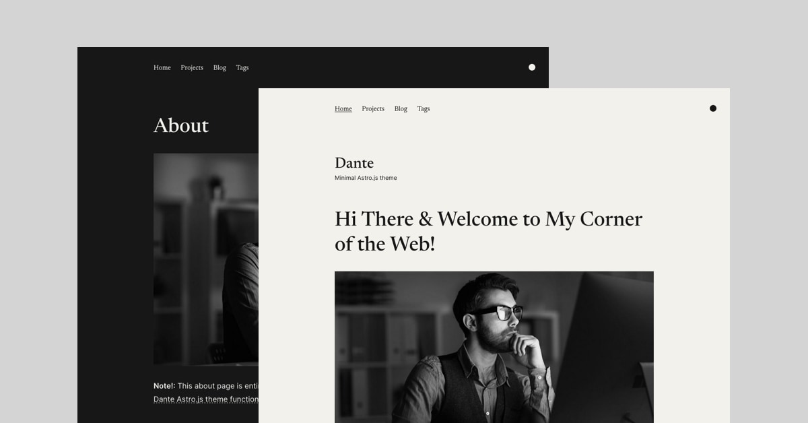

# Sungboo Yoon — Astro + Astryx Portfolio

A bilingual academic portfolio and blog built with Astro and the Astryx design system.



[](https://app.netlify.com/start/deploy?repository=https://github.com/JustGoodUI/dante-astro-theme)

Clicking the button above ☝️ will create a new repo for you that looks exactly like this one, and sets that repo up immediately for deployment on Netlify.

## Theme Features:

- ✅ Dark and light color mode
- ✅ Hero section with bio
- ✅ Portfolio collection
- ✅ Pagination support
- ✅ Post tags support
- ✅ Subscription form
- ✅ View transitions
- ✅ Astryx component system and custom theme
- ✅ Noto Sans KR / Noto Serif KR variable typography
- ✅ Mobile-first responsive layout
- ✅ SEO-friendly with canonical URLs and OpenGraph data
- ✅ Sitemap support
- ✅ RSS Feed support
- ✅ Markdown & MDX support
- ✅ Optimized images using Astro’s `Image` component

## Template Integrations

- @astryxdesign/core - https://astryx.atmeta.com/docs/getting-started
- @astryxdesign/theme-neutral - https://astryx.atmeta.com/docs/getting-started
- @astrojs/react - https://docs.astro.build/en/guides/integrations-guide/react/
- @astrojs/sitemap - https://docs.astro.build/en/guides/integrations-guide/sitemap/
- @astrojs/mdx - https://docs.astro.build/en/guides/markdown-content/
- @astrojs/rss - https://docs.astro.build/en/guides/rss/

## ⚙️ Configuration Notes

### `site-config.ts`

All site-wide data and theme options are stored in `src/data/site-config.ts`. It provides a single configuration object used throughout the theme for navigation, branding, hero content, social links, and more.

You can update this file to customize:

- Site identity — title, description, avatar, subtitle, and default social share image
- Navigation — header and footer navigation links
- Social links — URLs for supported platforms
- Hero section — title, text, image, and action buttons
- Newsletter subscription — form settings suitable for Mailchimp, Formspree, ConvertKit, or other form-based providers. The form supports a custom action URL, configurable email and hidden fields, and an optional honeypot field for spam protection.
- Pagination — posts per page for blog and projects listings

Images can be referenced either as imports from `src/assets/` (for optimized Astro images) or as string paths from the `public/` directory.

### Images

Hero and Markdown content images are optimized through Astro before being passed to Astryx components.

- Content collection images (used in posts or pages) must be stored in `src/assets/` since they use Astro’s `image()` schema.
- Site-config images (like the avatar, hero image, or social preview) can either be imported from `src/assets/` for optimization or referenced directly from `public/` if you prefer not to optimize them.

## Project Structure

Inside of Dante Astro theme, you'll see the following folders and files:

```text
├── public/
├── src/
│   ├── assets/
│   ├── components/
│   ├── content/
│   ├── data/
│   ├── icons/
│   ├── layouts/
│   ├── pages/
│   ├── styles/
│   ├── utils/
│   ├── content.config.ts
│   └── types.ts
├── astro.config.mjs
├── package.json
├── README.md
└── tsconfig.json
```

Astro looks for `.astro` or `.md` files in the `src/pages/` directory. Each page is exposed as a route based on its file name.

There's nothing special about `src/components/`, but that's where we like to put any Astro (`.astro`) components.

The `src/content/` directory contains "collections" of related Markdown and MDX documents. Use `getCollection()` to retrieve posts from `src/content/blog/`, and type-check your frontmatter using an optional schema. See [Astro's Content Collections docs](https://docs.astro.build/en/guides/content-collections/) to learn more.

Any static assets, like images, can be placed in the `public/` directory.

## Astro.js Commands

All commands are run from the root of the project, from a terminal:

| Command                   | Action                                           |
| :------------------------ | :----------------------------------------------- |
| `npm install`             | Installs dependencies                            |
| `npm run dev`             | Starts local dev server at `localhost:4321`      |
| `npm run build`           | Build your production site to `./dist/`          |
| `npm run preview`         | Preview your build locally, before deploying     |
| `npm run astro ...`       | Run CLI commands like `astro add`, `astro check` |
| `npm run astro -- --help` | Get help using the Astro CLI                     |

## Want to learn more about Astro.js?

Check out [our documentation](https://docs.astro.build) or jump into our [Discord server](https://astro.build/chat).

## Credits

- Demo content generate with [Chat GPT](https://chat.openai.com/)
- Images for demo content from [Unsplash](https://unsplash.com/)

## Astro Themes by Just Good UI

- [Ovidius](https://github.com/JustGoodUI/ovidius-astro-theme) is a free single author blog theme.

## License

Licensed under the [GPL-3.0](https://github.com/JustGoodUI/dante-astro-theme/blob/main/LICENSE) license.
